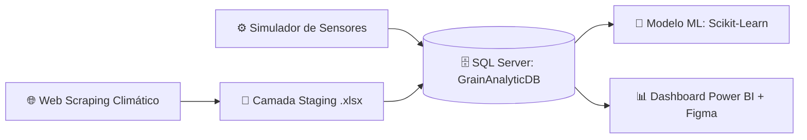
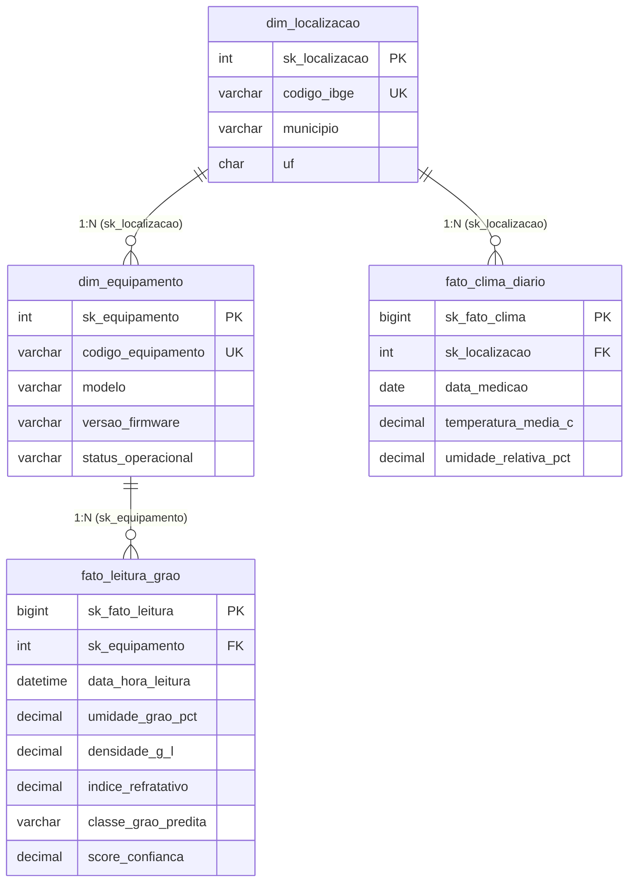

# 🌾 Grain Analytic System

Solução end-to-end de Engenharia de Dados, Machine Learning e Business Intelligence voltada para o monitoramento em tempo real da qualidade e umidade de grãos em unidades de beneficiamento e armazenagem.

## 🎯 Visão Geral do Projeto

O Grain Analytic System integra dados meteorológicos externos (via Web Scraping) e leituras físico-químicas de sensores ópticos/NIR de múltiplos equipamentos (EQ_CASCAVEL_01, EQ_PASSOFUNDO_01, EQ_RIOVERDE_01, EQ_SORRISO_01) para classificar grãos automaticamente e apoiar a tomada de decisão operacional.

Principais Funcionalidades

Pipeline ETL Automatizado: Extração de dados climáticos, higienização em camada staging (Excel/Pandas) e ingestão estruturada no SQL Server.

Modelagem Dimensional (Star Schema): Arquitetura de banco de dados relacional otimizada para consultas analíticas e alimentação de modelos preditivos.

Machine Learning com Validação Cruzada por Grupo (GroupKFold): Classificação preditiva de qualidade dos grãos (INTEIRO, ARDIDO, IMATURO, PICADO) garantindo generalização entre equipamentos distintos sem vazamento de dados, atingindo 99,5% de acurácia média.

Dashboard Executivo & UI/UX: Interface interativa no Power BI Desktop com design personalizado prototipado no Figma.

## 🏗️ Arquitetura e Fluxo de Dados



🛠️ Tecnologias Utilizadas

Linguagem & ETL: Python 3.x (pandas, numpy, SQLAlchemy, pyodbc, requests, beautifulsoup4)

Machine Learning: scikit-learn (GroupKFold)

Banco de Dados: Microsoft SQL Server (GrainAnalyticDB)

Business Intelligence: Power BI Desktop (DAX, Modelagem Estrela)

UI/UX Design: Figma (Prototipagem de layout e identidade visual)

## 📂 Estrutura do Repositório

```text
grain-analytic-system/
├── assets/
│   └── dashboard_preview.png                # Captura de tela do painel final
├── data/
│   └── staging/
│       └── stg_clima_multiequipamento.xlsx  # Arquivo intermediário de staging
├── src/
│   ├── database/
│   │   ├── carga_sql.py                     # Ingestão de dados de staging para o SQL Server
│   │   ├── gerar_leituras_reais.py          # Simulador de padrões físicos dos sensores
│   │   └── schema_grain_analytic.sql        # Scripts DDL (Staging, Dimensões e Fatos)
│   ├── models/
│   │   └── train_model.py                   # Treinamento e validação do modelo de classificação
│   └── scrapers/
│       └── scraper_clima.py                 # Coleta e higienização de dados meteorológicos
├── dashboard/
│   └── grain_analytic.pbix                  # Arquivo do projeto Power BI
├── etl_clima_scraping.py                    # Execução isolada do pipeline climático
├── main.py                                  # Orquestrador principal da pipeline
├── requirements.txt                         # Dependências do projeto
└── README.md                                # Documentação do projeto
```

## 🗄️ Arquitetura e Modelagem de Dados (SQL Server)

O banco de dados **`GrainAnalyticDB`** foi projetado sob o paradigma de **Modelagem Dimensional (Star Schema)**, separando a camada de ingestão bruta (*Staging*) das tabelas analíticas (*Dimensões* e *Fatos*) para otimizar o desempenho de consultas e o treinamento de modelos de Machine Learning.



### Dicionário de Tabelas

| Camada | Tabela | Finalidade |
| :--- | :--- | :--- |
| **Staging** | `dbo.stg_dados_clima` | Recepção bruta das coletas climáticas com auditoria (`data_processamento_etl`). |
| **Dimensão** | `dbo.dim_equipamento` | Cadastro das unidades físicas, modelos e versões de firmware. |
| **Dimensão** | `dbo.dim_localizacao` | Dados geográficos e regiões agrícolas das unidades. |
| **Fato** | `dbo.fato_leitura_grao` | Leituras de umidade, densidade, índice refratativo e predição ML. |
| **Fato** | `dbo.fato_clima_diario` | Série histórica climática consolidada por localização. |

---

## 📊 Camada Semântica e Indicadores (Power BI)

Painel executivo prototipado no **Figma**, com filtragem cruzada por **Equipamento** e **Data de Leitura**.

### Métricas e Regras de Negócio (DAX)

| Indicador (KPI) | Expressão DAX | Objetivo |
| :--- | :--- | :--- |
| **Total de Amostras** | `COUNTROWS(fato_leitura_grao)` | Volume total de leituras processadas. |
| **Umidade Média (%)** | `AVERAGE(fato_leitura_grao[umidade_grao_pct])` | Monitoramento do teor de água na armazenagem. |
| **% Grãos Inteiros** | `DIVIDE(CALCULATE([Total_Leituras], classe = "INTEIRO"), [Total_Leituras])` | Lotes dentro do padrão comercial ideal. |
| **% Grãos Avariados** | `DIVIDE(CALCULATE([Total_Leituras], classe IN {"ARDIDO", "IMATURO", "PICADO"}), [Total_Leituras])` | Taxa de defeitos para cálculo de deságio. |

### Visuais do Painel
* **Distribuição por Classe de Grão (Rosca):** Proporção volumétrica e percentual por classificação.
* **Média de Umidade ao Longo do Tempo (Área):** Monitoramento temporal para detecção de picos de umidade.
* **Volume de Amostra por Equipamento (Colunas):** Comparativo operacional entre as 4 unidades (`Cascavel`, `Passo Fundo`, `Rio Verde` e `Sorriso`).
* **Últimas Leituras de Grãos (Tabela):** Auditoria granular com timestamp, equipamento, umidade, densidade e classe predita.

---

## 🚀 Como Executar o Projeto

1. **Clone o repositório e instale as dependências:**
   ```bash
   git clone [https://github.com/paulohrlamorea/grain-analytic-system.git](https://github.com/paulohrlamorea/grain-analytic-system.git)
   cd grain-analytic-system
   pip install -r requirements.txt
   ```

2. **Configure o Banco de Dados:**
   * Rode `src/database/schema_grain_analytic.sql` no SSMS para criar o `GrainAnalyticDB`.
   * Ajuste `DB_SERVER` em `src/database/carga_sql.py` conforme sua instância (ex: `.\SQLEXPRESS`).

3. **Execute a pipeline e abra o painel:**
   ```bash
   python -m src.database.gerar_leituras_reais
   python main.py
   ```
   * Abra `dashboard/grain_analytic.pbix` no **Power BI Desktop** e atualize a conexão com o SQL Server.
