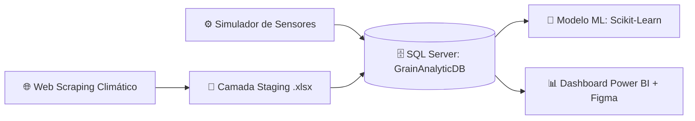
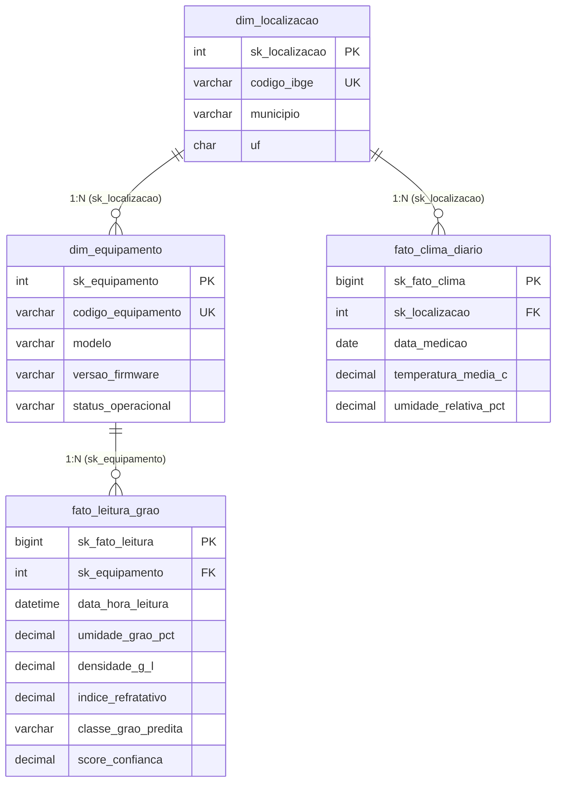

# 🌾 Grain Analytic System

Solução end-to-end de Engenharia de Dados, Machine Learning e Business Intelligence voltada para o monitoramento em tempo real da qualidade e umidade de grãos em unidades de beneficiamento e armazenagem.

## 🎯 Visão Geral do Projeto

O Grain Analytic System integra dados meteorológicos externos (via Web Scraping) e leituras físico-químicas de sensores ópticos/NIR de múltiplos equipamentos (EQ_CASCAVEL_01, EQ_PASSOFUNDO_01, EQ_RIOVERDE_01, EQ_SORRISO_01) para classificar grãos automaticamente e apoiar a tomada de decisão operacional.

Principais Funcionalidades

Pipeline ETL Automatizado: Extração de dados climáticos, higienização em camada staging (Excel/Pandas) e ingestão estruturada no SQL Server.

Modelagem Dimensional (Star Schema): Arquitetura de banco de dados relacional otimizada para consultas analíticas e alimentação de modelos preditivos.

Machine Learning com Validação Cruzada por Grupo (GroupKFold): Classificação preditiva de qualidade dos grãos (INTEIRO, ARDIDO, IMATURO, PICADO) garantindo generalização entre equipamentos distintos sem vazamento de dados, atingindo 99,5% de acurácia média.

Dashboard Executivo & UI/UX: Interface interativa no Power BI Desktop com design personalizado prototipado no Figma.

## 🏗️ Arquitetura e Fluxo de Dados



🛠️ Tecnologias Utilizadas

Linguagem & ETL: Python 3.x (pandas, numpy, SQLAlchemy, pyodbc, requests, beautifulsoup4)

Machine Learning: scikit-learn (GroupKFold)

Banco de Dados: Microsoft SQL Server (GrainAnalyticDB)

Business Intelligence: Power BI Desktop (DAX, Modelagem Estrela)

UI/UX Design: Figma (Prototipagem de layout e identidade visual)

## 📂 Estrutura do Repositório

```text
grain-analytic-system/
├── assets/
│   └── dashboard_preview.png                # Captura de tela do painel final
├── data/
│   └── staging/
│       └── stg_clima_multiequipamento.xlsx  # Arquivo intermediário de staging
├── src/
│   ├── database/
│   │   ├── carga_sql.py                     # Ingestão de dados de staging para o SQL Server
│   │   ├── gerar_leituras_reais.py          # Simulador de padrões físicos dos sensores
│   │   └── schema_grain_analytic.sql        # Scripts DDL (Staging, Dimensões e Fatos)
│   ├── models/
│   │   └── train_model.py                   # Treinamento e validação do modelo de classificação
│   └── scrapers/
│       └── scraper_clima.py                 # Coleta e higienização de dados meteorológicos
├── dashboard/
│   └── grain_analytic.pbix                  # Arquivo do projeto Power BI
├── etl_clima_scraping.py                    # Execução isolada do pipeline climático
├── main.py                                  # Orquestrador principal da pipeline
├── requirements.txt                         # Dependências do projeto
└── README.md                                # Documentação do projeto
```

## 🗄️ Arquitetura e Modelagem de Dados (SQL Server)

O banco de dados **`GrainAnalyticDB`** foi projetado sob o paradigma de **Modelagem Dimensional (Star Schema)**, separando a camada de ingestão bruta (*Staging*) das tabelas analíticas (*Dimensões* e *Fatos*) para otimizar o desempenho de consultas e o treinamento de modelos de Machine Learning.



### Dicionário de Tabelas

| Camada | Tabela | Granularidade e Finalidade |
| :--- | :--- | :--- |
| **Staging** | `dbo.stg_dados_clima` | Recepção bruta das coletas meteorológicas com carimbo de auditoria (`data_processamento_etl`). |
| **Dimensão** | `dbo.dim_equipamento` | Cadastro mestre das unidades físicas de análise, modelos e versões de firmware. |
| **Dimensão** | `dbo.dim_localizacao` | Atributos geográficos e macrorregiões agrícolas das unidades monitoradas. |
| **Fato** | `dbo.fato_leitura_grao` | Registro transacional por amostra analisada (umidade, densidade, índice refratativo e predição ML). |
| **Fato** | `dbo.fato_clima_diario` | Série histórica consolidada das variáveis climáticas diárias por localização. |

---

## 📊 Camada Semântica e Indicadores (Power BI)

O dashboard executivo foi desenvolvido aplicando princípios de **Data Storytelling** e **UI/UX Design** (prototipado previamente no Figma), permitindo filtragem cruzada por **Equipamento** e **Janela Temporal**.

### Métricas e Regras de Negócio (DAX)

| Indicador (KPI) | Lógica / Expressão DAX | Objetivo Analítico |
| :--- | :--- | :--- |
| **Total de Amostras** | `COUNTROWS(fato_leitura_grao)` | Volume total de grãos processados pelos sensores no período filtrado. |
| **Umidade Média (%)** | `AVERAGE(fato_leitura_grao[umidade_grao_pct])` | Monitoramento crítico do teor de água para prevenção de fermentação e perdas na armazenagem. |
| **% Grãos Inteiros** | `DIVIDE(CALCULATE([Total_Leituras], classe = "INTEIRO"), [Total_Leituras])` | Índice de qualidade padrão (lotes dentro da especificação comercial ideal). |
| **% Grãos Avariados** | `DIVIDE(CALCULATE([Total_Leituras], classe IN {"ARDIDO", "IMATURO", "PICADO"}), [Total_Leituras])` | Taxa consolidada de defeitos para cálculo de deságio e triagem operacional. |

### Arquitetura Visual do Painel
* **Distribuição por Classe de Grão (Gráfico de Rosca):** Composição volumétrica e percentual das classes preditas pelo algoritmo de classificação.
* **Média de Umidade ao Longo do Tempo (Gráfico de Área):** Análise de série temporal para detecção rápida de anomalias e picos de umidade por lote.
* **Volume de Amostra por Equipamento (Gráfico de Colunas):** Balanceamento de carga e disponibilidade operacional entre as unidades (`Cascavel`, `Passo Fundo`, `Rio Verde` e `Sorriso`).
* **Últimas Leituras de Grãos (Tabela Analítica):** Visão granular de auditoria exibindo timestamp, equipamento, umidade (`%`), densidade (`g/L`) e classificação atribuída.

🚀 Como Executar o Projeto

Clone o repositório:

git clone https://github.com/paulohrlamorea/grain-analytic-system.git
cd grain-analytic-system


Instale as dependências:

pip install -r requirements.txt


Configure o Banco de Dados:

Execute o script src/database/schema_grain_analytic.sql no SQL Server Management Studio (SSMS) para criar o banco GrainAnalyticDB e suas tabelas.

Ajuste a variável DB_SERVER em src/database/carga_sql.py conforme sua instância local (ex: .\SQLEXPRESS).

Popule os dados e execute a pipeline:

python -m src.database.gerar_leituras_reais
python main.py


Visualize o Dashboard:

Abra o arquivo .pbix no Power BI Desktop e atualize a fonte de dados apontando para a sua instância local do SQL Server.

